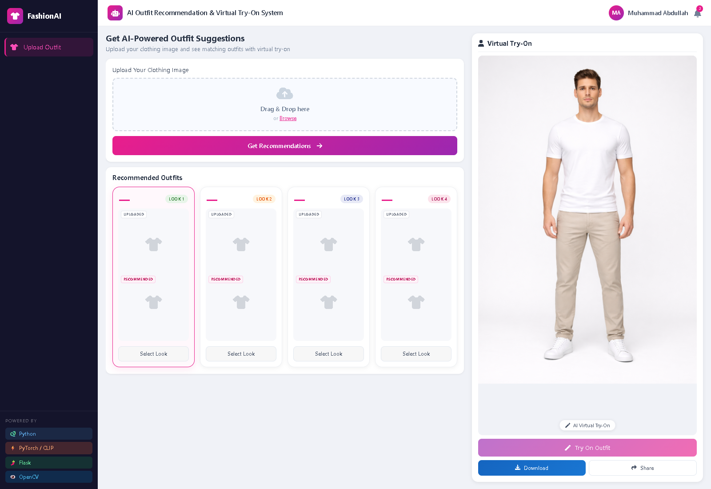
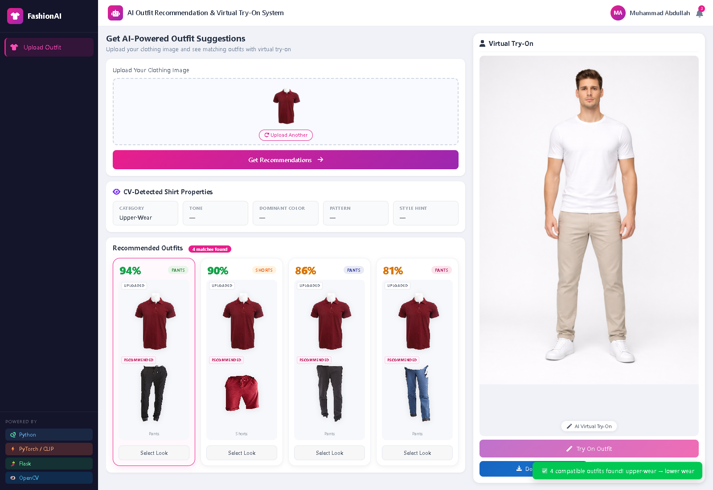

# FashionAI — Outfit Recommendations & Virtual Try-On

A Flask application that finds complementary garments with OpenAI CLIP and creates a full outfit preview with a customized, CPU-capable OOTDiffusion pipeline.



## Features

- Upload PNG, JPEG, or WebP clothing images (maximum 16 MB).
- Detect upper, lower, outerwear, and full-body garment categories using catalog lookup, filename hints, image analysis, and CLIP zero-shot classification.
- Rank complementary catalog items with CLIP embeddings, view preferences, and garment quality heuristics.
- Display up to four recommendations with segmentation-based transparent garment crops.
- Apply an upper garment with the OOTDiffusion HD model, then a lower garment with the DC model.
- Track background inference progress and download the generated image.



These are screenshots of the running application with a real recommendation response. The model preview in these screenshots is the base photo, not a newly generated try-on result.

## How it works

```text
Browser → Flask upload → CLIP embedding/category detection
                       → complementary category filter → ranked catalog results
                       → segmentation masks → garment previews

Selected upper + lower garments → HD upper-body pass → DC lower-body pass
                               → progress polling → downloadable PNG
```

Similarity percentages and color/style scores are heuristics, not calibrated probabilities or independently measured fashion compatibility. The current interface spreads tightly clustered scores by rank. Some detected-property fields are placeholders because the API returns a category rather than detailed color/style analysis.

## Prerequisites

- Windows with Python **3.13** for the web application and Python **3.10** for OOTDiffusion.
- Git and internet access for dependencies and model downloads.
- A locally obtained, appropriately licensed DeepFashion-style catalog and segmentation masks.
- OOTDiffusion checkpoints, downloaded separately. They are large and are not stored in Git.

The Flask integration currently uses `ootd_env/Scripts/python.exe` and forces `--gpu_id -1`, so inference runs on CPU. CPU generation can be very slow and memory intensive. CUDA requires changing the subprocess configuration and installing compatible GPU packages. Linux/macOS require changing the interpreter path in `app.py`.

## Setup (PowerShell)

### 1. Clone and install the web application

```powershell
git clone https://github.com/sheikhabdullah9july-commits/virtual-try-on-system.git
cd virtual-try-on-system
py -3.13 -m venv venv
.\venv\Scripts\python.exe -m pip install --upgrade pip
.\venv\Scripts\python.exe -m pip install torch==2.11.0+cpu torchvision==0.26.0+cpu --index-url https://download.pytorch.org/whl/cpu
.\venv\Scripts\python.exe -m pip install -r requirements.txt
```

The dependency files record the local project's versions. A fresh installation has not yet been verified on a clean machine. `openai-clip` uses `pkg_resources`; install `setuptools<81` if that import is missing.

### 2. Supply the catalog and a base model photo

```text
Kaggle_datasets/
  train_images/                 # e.g. MEN-Pants-id_00000470-01_1_front.png
  segm/                         # matching filename stem + _segm.png
  shape_ann/train_ann_file.txt  # optional shape annotations
  texture_ann/train/            # optional *_fused.txt annotations
static/model/
  base_model.jpg                # full-body, front-facing person photo
```

Use images you have permission to process. Dataset and personal image files are excluded from version control. The catalog filenames encode garment categories; see `GARMENT_TYPE` in `build_index.py`. Segmentation labels used here are `1` for upper garments and `5` for lower garments. Missing masks fall back to full catalog photos.

Build the local CLIP index:

```powershell
.\venv\Scripts\python.exe build_index.py
```

This creates `catalog_vectors.npy` and `catalog_metadata.json`. Both are generated locally and ignored by Git. The first CLIP use downloads its ViT-B/32 weights. Lower `BATCH_SIZE` in `build_index.py` if indexing exceeds available memory.

### 3. Install the separate inference environment

```powershell
py -3.10 -m venv ootd_env
.\ootd_env\Scripts\python.exe -m pip install --upgrade pip
.\ootd_env\Scripts\python.exe -m pip install torch==2.0.1 torchvision==0.15.2 torchaudio==2.0.2 --index-url https://download.pytorch.org/whl/cpu
.\ootd_env\Scripts\python.exe -m pip install -r ootd_requirements.txt
```

Use the **root** `ootd_env`, not `OOTDiffusion/ootd_env`. The latter is an unrelated local environment and is excluded. The pinned `huggingface-hub==0.21.3` is needed by this older Diffusers stack; newer Hub versions can remove `cached_download` and break imports.

Download the assets referenced in the bundled [upstream instructions](OOTDiffusion/README.md) from [OOTDiffusion checkpoints](https://huggingface.co/levihsu/OOTDiffusion) and [CLIP ViT-L/14](https://huggingface.co/openai/clip-vit-large-patch14). Preserve their directory structure:

```text
OOTDiffusion/checkpoints/
  ootd/
    model_index.json
    vae/
    text_encoder/
    tokenizer/
    scheduler/
    feature_extractor/
    ootd_hd/checkpoint-36000/{unet_garm,unet_vton}/
    ootd_dc/checkpoint-36000/{unet_garm,unet_vton}/
  humanparsing/{parsing_atr.onnx,parsing_lip.onnx}
  openpose/ckpts/body_pose_model.pth
  clip-vit-large-patch14/
```

The CLIP vision encoder can download automatically if its local folder is absent. Do not create an empty local encoder folder: its existence makes the code prefer local files.

### 4. Start the application

```powershell
.\venv\Scripts\python.exe app.py
```

Open **http://127.0.0.1:5000**. Upload a shirt or pants image, click **Get Recommendations**, select a look, and use the try-on controls. Debug mode is off by default; set `$env:FLASK_DEBUG = '1'` for local debugging.

## API

| Method | Route | Purpose |
|---|---|---|
| GET | `/` | Web interface |
| POST | `/upload` | Multipart image upload with field `file` |
| POST | `/api/recommend` | JSON `{ "filepath": "<uploaded path>" }` |
| GET | `/api/model-image` | Base model image |
| GET | `/catalog-image/<filename>` | Catalog image |
| GET | `/catalog-crop/<filename>/<garment_type>` | Garment crop |
| POST | `/tryon` | JSON with `uploaded_filepath`, `catalog_filename`, `uploaded_type` |
| GET | `/tryon/progress/<job_id>` | Status, progress, result URL, or error |

Try-on currently accepts `upper` and `lower` uploads. Outerwear/full-body recommendations do not have a matching try-on workflow. Inference runs serially because the upstream pipeline writes fixed output filenames. Job state is held in memory and is lost on restart. Run a single application process for this design.

## Project structure

```text
app.py                 Flask routes, image preparation, background inference
recommender.py         CLIP detection, filtering, ranking
build_index.py         Catalog embedding generation
garment_cleaner.py     Garment extraction and quality heuristics
templates/index.html   Interface
static/css/style.css   Styling
static/js/main.js      Upload, recommendations, selection, polling
OOTDiffusion/          Vendored upstream source with local CPU adaptations
tests/test_app.py      Upload and route regression checks
docs/screenshots/      Screenshots from the running application
```

## Validation and limitations

Run the regression checks:

```powershell
.\venv\Scripts\python.exe -m unittest discover -s tests -v
```

The review verified page rendering, image upload, four real CLIP recommendations, catalog crop responses, invalid-image rejection, upload-directory boundaries, and missing-input/job handling. Full 40-step, two-pass generation has not been verified in this review; existing generated images are not evidence of a newly completed run. See [review notes](docs/REVIEW.md) for the final environment findings.

This is a local prototype. It has no user authentication, persistent job queue, or automatic cleanup of uploads and jobs. Bootstrap and Font Awesome load from external CDNs. Do not expose the development server directly to the internet.

## Attribution

The bundled OOTDiffusion source comes from [levihsu/OOTDiffusion](https://github.com/levihsu/OOTDiffusion), upstream commit `13ef0faba266cdde9febc8ad39be2395bbb89d9c`. Local adaptations include CPU device handling, model paths, preprocessing, and the inference runner. Its [CC BY-NC-SA 4.0 license](OOTDiffusion/LICENSE) and existing third-party notices are preserved. Dataset/model/image licenses remain with their respective providers; this repository does not grant rights to those assets. No additional license is assigned to the original application code here.
